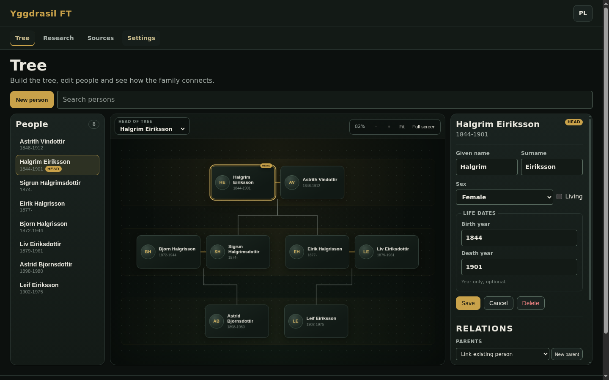
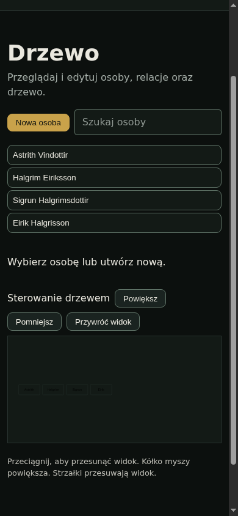
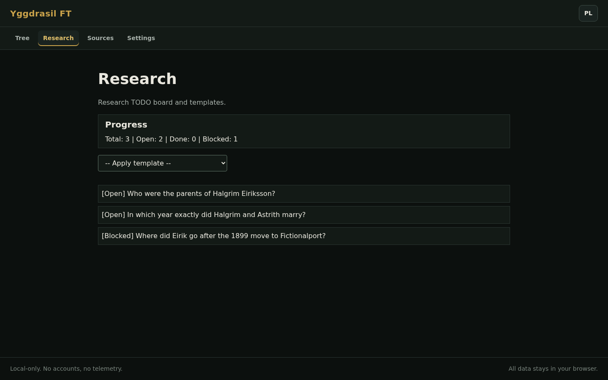

# Yggdrasil-ft

**An offline-first family tree with a research TODO board.** Build ancestry in
the browser, keep track of where to look next, and keep every byte of family
data on your own machine.

[Live demo](https://rur1k1d.github.io/yggdrasil-ft/) ·
[Project plan](plan.md) · [Privacy contract](docs/privacy.md) ·
[GEDCOM notes](docs/gedcom.md) · MIT

> **Status: v0.2.0 (2026-10-23).** Builds on the first public release with a
> rebuilt tree workspace: generation cards and connectors, a focal person in the
> URL, drag-to-link with a relation chooser, life dates, search highlighting, an
> unlinked-person tray, fit/full-screen controls and a richer fictional demo.
> The rest of the v0.1.0 workflow remains: research board, source registry,
> JSON/GEDCOM import and export, English/Polish UI and an installable offline PWA.
> Every load opens with a five-second DataRain splash that can be skipped.

| Desktop, English | Mobile, Polish |
|---|---|
|  |  |

## What works today

- **People:** create, edit and delete persons (given name, surname, sex, living
  flag, optional birth and death years). Deletion asks for confirmation.
- **Relations:** grouped parents, partners and children; link an existing person
  or create a new relative, then unlink without deleting the person. Duplicate,
  self, ancestry-cycle and partner/ancestor conflicts are rejected.
- **Tree workspace:** generation cards connected by SVG edges, a focal person
  stored in `#/tree/<id>`, click selection, drag-to-link with a keyboard-trapped
  confirmation dialog, search that dims non-matches without hiding them, and a
  tray for people outside the current tree.
- **Tree controls:** drag to pan, wheel or `+`/`-` to zoom, `0` to fit, arrow
  keys when a card has focus, fit and full-screen buttons, and a mobile opening
  zoom that keeps cards readable.
- **Demo data:** replace personal data with the fictional three-generation tree
  from Settings, after confirmation.
- **Research board:** apply question templates to the whole tree or one person,
  see progress counts and the task list with open/done/blocked/dropped status.
- **Sources:** registry with type, quality, repository, reference, URL,
  accessed date, transcription and note.
- **Import/export:** JSON backups and GEDCOM 5.5.1 (documented subset, see
  [docs/gedcom.md](docs/gedcom.md)).
- **Localization:** English (default) and Polish, with a language switch in the
  header and in Settings; the choice is remembered in this browser.
- **PWA:** installable, works offline after the first visit, no external
  requests at runtime.
- **Accessibility and layout:** keyboard-operable tree, visible focus, labelled
  controls, a focus trap and focus return in the relation dialog, body scroll
  lock, reduced-motion support, layouts tested from 320 to 1440 px.



## Not in the UI yet

These exist in the model or as library code but are deliberately not advertised
as finished features:

- Editing research task details (status, priority, hypothesis, next action,
  outcome) and linking sources to tasks. Tasks currently come from templates
  and render read-only.
- Markdown research export, per-person reports, print styles and privacy-mode
  masking. The modules exist, the UI does not.
- Attachments, photos, timeline and map views (planned for a later release).
- Touch pinch-zoom on the tree. Mobile opens at a readable zoom and supports
  drag-to-pan; the `Fit` button shows the whole chart.

## Privacy

- There is no backend, no account, no sync, no telemetry and no third-party
  script or font. The app holds all state in `localStorage` under
  `yggdrasil_ft_v1`.
- The repository ships a **fictional seed only**. Real trees are git-ignored
  (everything under `data/` except the seed, plus `vault/` and `*.ged`).
- Clearing browser storage deletes the tree, so export a JSON backup regularly.
- The published demo is the app with its fictional seed. Full contract:
  [docs/privacy.md](docs/privacy.md).

## Quick start

Requires Node 22.12 or newer (tested on Node 24, which CI uses).

```bash
npm ci
npm run dev        # http://127.0.0.1:5173
```

Production build and local preview:

```bash
npm run build      # static output in dist/
npm run preview
```

## Checks

```bash
npm run verify      # Biome, TypeScript, Vitest (66 tests), production build
npm run probe       # PWA: online boot, service worker, offline boot
npm run probe:pages # dist served under /yggdrasil-ft/: manifest, icons, SW scope, offline
npm run probe:ui    # 63 checks: intro, language default, responsive routes, tree features; writes docs/img
```

The probes drive headless Chromium over CDP and have no extra dependencies. Set
`CHROMIUM_BIN` if Chromium is not at `/usr/bin/chromium`. CI runs `verify`,
`probe` and `probe:pages` on every push and pull request; the Pages workflow
deploys `dist` to GitHub Pages.

## Project layout

```
src/model      document types and schema
src/store      localStorage store, migrations, seed
src/io         JSON and GEDCOM 5.5.1 import/export
src/components tree canvas, relation dialog, forms, research, sources, data IO
src/lib        dates, relation rules, tree layout, validation
src/i18n       English and Polish dictionaries
scripts        headless Chromium probes (PWA, Pages mount, responsive)
```

## Use it as a template

The repo is set up to be copied: the data layer, i18n and probes are generic and
the demo content is fictional.

1. Click **Use this template** on GitHub (or fork the repo).
2. Run `npm ci && npm run dev`.
3. To start with an empty tree, open DevTools, remove the `yggdrasil_ft_v1`
   localStorage entry and reload, or import your own JSON backup.
4. Keep the MIT license notice, or replace the copyright line if you ship a
   substantially modified version.

## Naming note

The name follows the Norse world tree, a natural fit for a family tree. It is
**not** related to the Yggdrasil Network (`yggdrasil-network/*`, an encrypted
IPv6 overlay) or to other projects that share the name. `-ft` stands for
*family tree*. Prior art acknowledged: `KeithPetro/Yggdrasil` and
`marioparra/yggdrasil-opensource` (self-hosted GEDCOM viewers). This project
differs by being fully offline and by putting the research workflow first.

## License

MIT © 2026 Ivan Kryvosheyev. See [LICENSE](LICENSE).
